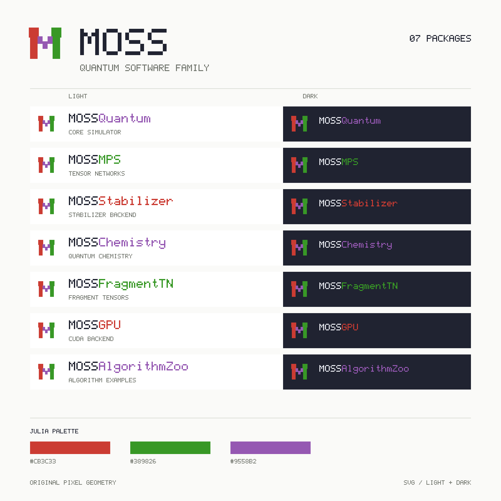

# MOSS 家族图标与像素字标

MOSS 家族使用统一图标，并为每个包提供保留完整名称和大小写的独立像素字标。共享的方格几何与红、绿、紫三色连接各个文档站、仓库和导出资源。

[下载完整品牌资源包（SVG + 透明 PNG）](assets/brand/moss-family-brand-kit.zip) · [查看 PNG 总览](assets/brand/family-overview.png)

## 图标与配色

统一图标以原创像素 **M** 为主体，两侧立柱和中央阶梯形成清晰轮廓，三个方形节点与直角连接表达量子线路和张量网络。图标可独立用于站点标识，也可与各包字标组成横向组合。

红、绿、紫三种基色参考 [Julia 官方色表](https://github.com/JuliaLang/julia-logo-graphics/blob/master/images/julia-colors.svg)：

| 颜色 | HEX |
| --- | --- |
| 红 | `#CB3C33` |
| 绿 | `#389826` |
| 紫 | `#9558B2` |

[获取统一图标 SVG](assets/brand/moss-icon.svg)。图标与字标均保留透明背景，适合在文档页、仓库说明和演示材料中复用。

## 七个包的字标

名称严格使用下表的大小写。只有核心包 `MOSSQuantum` 的名称保留 `Quantum`，其余库包采用各自的短名；`MOSSAlgorithmZoo` 为案例集合。

字标固定了各字符的像素形状和大小写，使用时无需额外字体。浅色版适合浅色底，深色版适合深色底；图标与字标组合的相对位置已固定，可整体缩放使用。

| 包名 | 像素字标 | 图标与字标组合 |
| --- | --- | --- |
| `MOSSQuantum` | [浅色版](assets/brand/packages/MOSSQuantum/wordmark.svg) · [深色版](assets/brand/packages/MOSSQuantum/wordmark-dark.svg) | [浅色版](assets/brand/packages/MOSSQuantum/lockup.svg) · [深色版](assets/brand/packages/MOSSQuantum/lockup-dark.svg) |
| `MOSSMPS` | [浅色版](assets/brand/packages/MOSSMPS/wordmark.svg) · [深色版](assets/brand/packages/MOSSMPS/wordmark-dark.svg) | [浅色版](assets/brand/packages/MOSSMPS/lockup.svg) · [深色版](assets/brand/packages/MOSSMPS/lockup-dark.svg) |
| `MOSSStabilizer` | [浅色版](assets/brand/packages/MOSSStabilizer/wordmark.svg) · [深色版](assets/brand/packages/MOSSStabilizer/wordmark-dark.svg) | [浅色版](assets/brand/packages/MOSSStabilizer/lockup.svg) · [深色版](assets/brand/packages/MOSSStabilizer/lockup-dark.svg) |
| `MOSSChemistry` | [浅色版](assets/brand/packages/MOSSChemistry/wordmark.svg) · [深色版](assets/brand/packages/MOSSChemistry/wordmark-dark.svg) | [浅色版](assets/brand/packages/MOSSChemistry/lockup.svg) · [深色版](assets/brand/packages/MOSSChemistry/lockup-dark.svg) |
| `MOSSFragmentTN` | [浅色版](assets/brand/packages/MOSSFragmentTN/wordmark.svg) · [深色版](assets/brand/packages/MOSSFragmentTN/wordmark-dark.svg) | [浅色版](assets/brand/packages/MOSSFragmentTN/lockup.svg) · [深色版](assets/brand/packages/MOSSFragmentTN/lockup-dark.svg) |
| `MOSSGPU` | [浅色版](assets/brand/packages/MOSSGPU/wordmark.svg) · [深色版](assets/brand/packages/MOSSGPU/wordmark-dark.svg) | [浅色版](assets/brand/packages/MOSSGPU/lockup.svg) · [深色版](assets/brand/packages/MOSSGPU/lockup-dark.svg) |
| `MOSSAlgorithmZoo` | [浅色版](assets/brand/packages/MOSSAlgorithmZoo/wordmark.svg) · [深色版](assets/brand/packages/MOSSAlgorithmZoo/wordmark-dark.svg) | [浅色版](assets/brand/packages/MOSSAlgorithmZoo/lockup.svg) · [深色版](assets/brand/packages/MOSSAlgorithmZoo/lockup-dark.svg) |

## 资源包与窄栏版

[完整品牌资源包](assets/brand/moss-family-brand-kit.zip)包含统一图标、七个包的独立字标及图标组合，提供 SVG 和透明 PNG，并配有浅色、深色版本。统一图标 PNG 包含 `32`、`64`、`128`、`512`、`1024` 像素尺寸；各包也有对应的浅色、深色 PNG，便于在仓库说明、演示文稿和其他应用中直接使用。

每个包同时提供 compact 字标，适合宽度受限的布局。常规版、compact 版和图标组合分别保存，使用时保持原始纵横比与周围留白。

| 包名 | Compact 字标 |
| --- | --- |
| `MOSSQuantum` | [浅色版](assets/brand/packages/MOSSQuantum/wordmark-compact.svg) · [深色版](assets/brand/packages/MOSSQuantum/wordmark-compact-dark.svg) |
| `MOSSMPS` | [浅色版](assets/brand/packages/MOSSMPS/wordmark-compact.svg) · [深色版](assets/brand/packages/MOSSMPS/wordmark-compact-dark.svg) |
| `MOSSStabilizer` | [浅色版](assets/brand/packages/MOSSStabilizer/wordmark-compact.svg) · [深色版](assets/brand/packages/MOSSStabilizer/wordmark-compact-dark.svg) |
| `MOSSChemistry` | [浅色版](assets/brand/packages/MOSSChemistry/wordmark-compact.svg) · [深色版](assets/brand/packages/MOSSChemistry/wordmark-compact-dark.svg) |
| `MOSSFragmentTN` | [浅色版](assets/brand/packages/MOSSFragmentTN/wordmark-compact.svg) · [深色版](assets/brand/packages/MOSSFragmentTN/wordmark-compact-dark.svg) |
| `MOSSGPU` | [浅色版](assets/brand/packages/MOSSGPU/wordmark-compact.svg) · [深色版](assets/brand/packages/MOSSGPU/wordmark-compact-dark.svg) |
| `MOSSAlgorithmZoo` | [浅色版](assets/brand/packages/MOSSAlgorithmZoo/wordmark-compact.svg) · [深色版](assets/brand/packages/MOSSAlgorithmZoo/wordmark-compact-dark.svg) |

每个仓库的 `docs/assets/brand/` 均包含该包的资源：

| 文件 | 用途 |
| --- | --- |
| `moss-icon.svg` | 家族共享图标 |
| `wordmark.svg`、`wordmark-dark.svg` | 完整包名的像素字标 |
| `wordmark-compact.svg`、`wordmark-compact-dark.svg` | 窄栏字标 |
| `lockup.svg`、`lockup-dark.svg` | 统一图标与本包字标的组合 |

核心仓库还在 `docs/assets/brand/packages/<包名>/` 汇总七个包的字标及组合，并提供上方的 `family-overview.svg` 总览。表中的链接可直接打开相应 SVG 文件。
