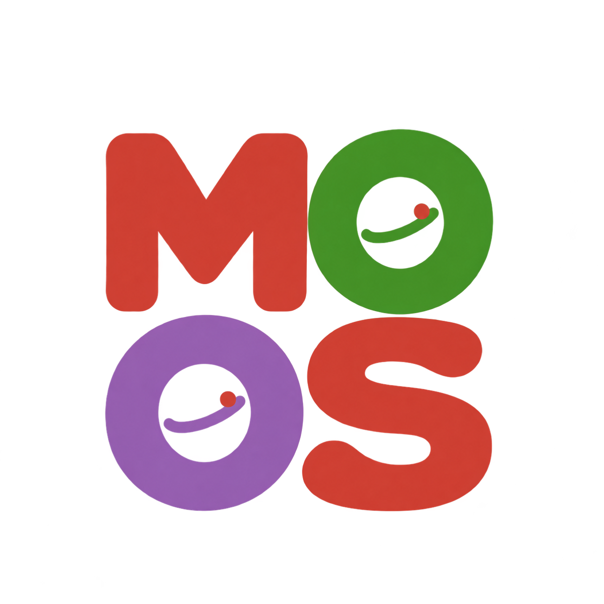

# MOOS 家族展示图标与品牌素材

[下载透明 PNG](assets/brand/moos-qubit-grid.png) · [下载品牌素材包 ZIP](assets/brand/moss-family-brand-kit.zip)

## 图形与配色

图形采用圆润粗字形和紧凑的田字布局，按行读取为 **MOOS**：上排 **MO**，下排 **OS**。两个 O 保留醒目的圆环与开放内孔，各加入一条同色圆弧和一枚小红色状态点，呈现轻松的卡通量子位意象。

| 位置 | 字形 | 参考配色 |
| --- | --- | --- |
| 左上 | M | 红 `#CB3C33` |
| 右上 | O | 绿 `#389826` |
| 左下 | O | 紫 `#9558B2` |
| 右下 | S | 红 `#CB3C33` |

三色参考 [Julia 官方色表](https://github.com/JuliaLang/julia-logo-graphics/blob/master/images/julia-colors.svg)。透明背景、圆润轮廓和统一的两行排布便于在仓库、文档和演示材料中使用。

## 展示图标与项目名称

**MOOS** 是图形中的排字。Julia 包、GitHub 仓库和 API 文档继续使用各自的名称：`MOSSQuantum`、`MOSSMPS`、`MOSSStabilizer`、`MOSSChemistry`、`MOSSFragmentTN`、`MOSSGPU`、`MOSSAlgorithmZoo`。

## 下载与使用

可直接下载上方透明 PNG，或获取品牌素材包。展示时保持图形的原始纵横比、田字排布、配色和周围留白；文档首页与 README 使用同一图稿。
